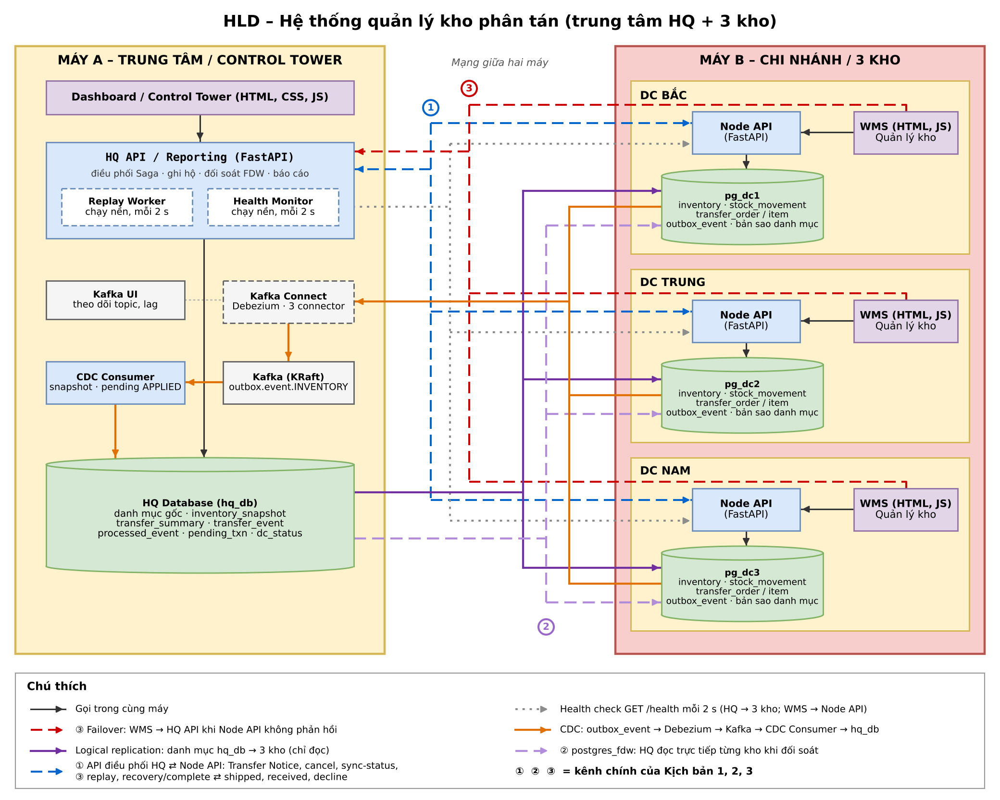
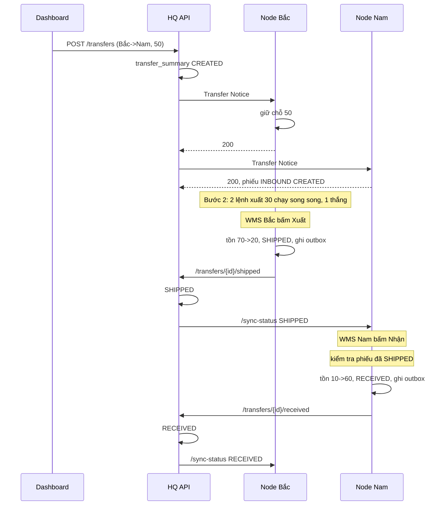
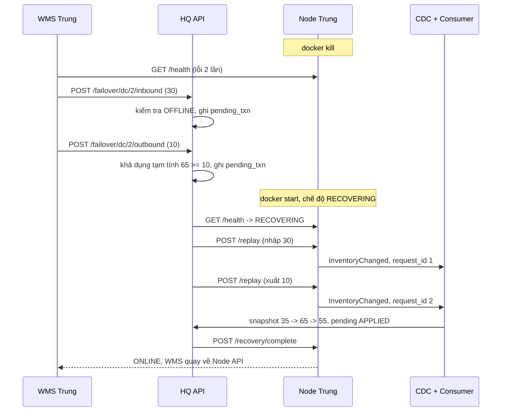

# HLD

Nhóm tự vẽ lại hình HLD trên draw.io theo các yêu cầu dưới đây rồi lưu thành docs/hld.png. Tên thành phần, container, cổng và kênh trao đổi trên hình phải khớp với thẻ Đặc tả kỹ thuật.

## 1\. Yêu cầu khi vẽ lại hình chính

1. Khung hai máy: "Máy A – Trung tâm" chứa Dashboard, HQ API, CDC Consumer, HQ Database, Kafka, Kafka Connect (Debezium), Kafka UI; "Máy B – 3 kho" chứa 3 khối DC, mỗi khối gồm WMS → Node API → pg\_dcX.  
2. Tác vụ nền: vẽ Health Monitor và Replay Worker bên trong hoặc ngay dưới khối HQ API.  
3. Khối HQ Database ghi: danh mục gốc · inventory\_snapshot · transfer\_summary · transfer\_event · processed\_event · pending\_txn · dc\_status.  
4. Khối pg\_dcX ghi: inventory · stock\_movement · transfer\_order / item · outbox\_event · bản sao danh mục.  
5. API hai chiều: HQ API → Node API ghi "Transfer Notice · cancel · sync-status · replay · recovery/complete"; Node API → HQ API ghi "shipped · received (Receipt Confirmation) · decline".  
6. Health check: Health Monitor → 3 Node API và WMS → Node API của kho mình, nhãn "GET /health mỗi 2 s".  
7. Failover: WMS Trung → HQ API, nhãn "failover khi Node API không phản hồi", ghi chú "áp dụng cho cả 3 kho".  
8. Tách logical replication và FDW thành hai đường riêng từ HQ Database xuống các pg\_dcX, không đi chung và không cắt qua khung HQ.  
9. Chú thích và nhãn kịch bản: thêm hộp chú thích ở góc dưới bên phải gồm 6 dòng của bảng mục 2, cộng dòng "① ② ③ \= kênh chính của Kịch bản 1, 2, 3". Gắn huy hiệu ① cạnh mũi tên API điều phối, ② cạnh đường FDW, ③ cạnh đường failover và đường replay.

## 2\. Chú thích kênh

| Kênh | Chiều | Kiểu nét gợi ý |
| :---- | :---- | :---- |
| API điều phối (Saga, replay) | HQ API ⇄ Node API | Nét đứt, xanh dương |
| Health check | HQ → kho; WMS → Node API | Nét chấm, xám |
| Failover | WMS → HQ API | Nét đứt, đỏ |
| CDC | pg\_dcX → Debezium → Kafka → Consumer → HQ DB | Nét liền, cam |
| Logical replication | HQ DB → pg\_dcX | Nét liền, tím |
| postgres\_fdw | HQ DB → pg\_dcX | Nét đứt, tím nhạt |

## 3\. Hình phụ (tùy chọn): luồng khi kho Trung sập

Chép hình chính, làm mờ khối Node API và pg\_dc2, chỉ giữ các mũi tên: WMS Trung → HQ API (failover) → pending\_txn; Replay Worker → Node API Trung (/replay) → pg\_dc2 → CDC → Consumer → pending\_txn APPLIED. Đặt tiêu đề hình kèm số bước của Kịch bản 3\.

\[Dán hình 2 tại đây\]

## 4\. Sơ đồ tuần tự

Dựng hai sơ đồ tuần tự trên draw.io (Arrange → Insert → Advanced → Mermaid) hoặc mermaid.live từ hai đoạn mã dưới, rồi dán ảnh vào đây.

Kịch bản 1:

Kịch bản 3:

